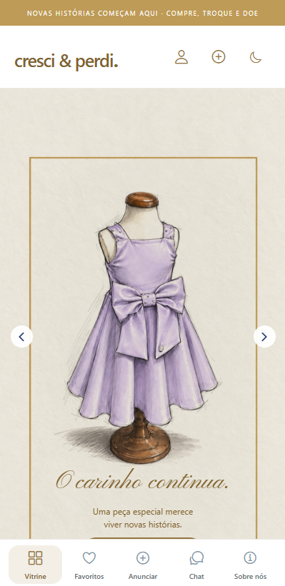

# 🧸 Cresci e Perdi — Marketplace Infantil Full Stack

**React Native • Expo • React • Node.js • Express • MySQL • API REST**

O **Cresci e Perdi** é um marketplace infantil desenvolvido de forma independente para conectar pessoas interessadas em **comprar, vender, trocar ou doar roupas e calçados infantis**. A plataforma reúne catálogo de anúncios, gerenciamento de peças, comunicação entre usuários e recursos de segurança em uma experiência adaptada à web e a dispositivos móveis.

🌐 **[Acessar demonstração web](https://cresci-e-perdi-app.onrender.com/)**

> **Sobre o projeto:** o código-fonte completo é mantido em repositório privado. Este repositório público apresenta a solução, sua arquitetura e uma demonstração para avaliação de portfólio.

## 📸 Demonstração visual

Abaixo estão capturas reais da interface mobile do projeto, incluindo o carrossel de apresentação e os principais fluxos de navegação.

### 🏠 Página inicial — carrossel

Três destaques da experiência de entrada, com identidade visual própria e foco em moda infantil circular.

<p align="center">
  
  
  
</p>

### 🔐 Autenticação — login e cadastro

Fluxos de acesso e criação de conta, com campos de identificação e navegação entre telas.

<p align="center">
  
  
</p>

### 📦 Publicação de anúncios

Formulário para cadastrar peças, escolher categoria e definir se o anúncio é para venda, troca ou doação.

<p align="center"></p>

### 💬 Chat e favoritos

Áreas de comunicação e de itens salvos. As imagens mostram os estados vazios dessas seções, não conversas ou favoritos já cadastrados.

<p align="center">
  
  
</p>

### 🌱 Sobre a plataforma

Apresentação da proposta de reaproveitamento de roupas e calçados infantis.

<p align="center"></p>

## 🎯 Objetivo

Desenvolver uma plataforma de economia circular voltada ao público infantil, aplicando conceitos de desenvolvimento **Full Stack**, experiência do usuário, regras de negócio, persistência relacional, autenticação e comunicação entre participantes de um marketplace.

## 🚀 Funcionalidades

### Catálogo e descoberta
- Vitrine pública de anúncios com carrossel e paginação.
- Busca e filtros por categoria, tamanho, modalidade, localização e faixa de preço.
- Categorias e faixas etárias para bebês e crianças.
- Favoritos e visualização de detalhes das peças.

### Publicação e gerenciamento
- Criação e edição de anúncios com até cinco fotos.
- Pré-visualização, escolha da capa e reordenação de imagens.
- Rascunho de anúncio salvo localmente por conta.
- Painel **Meus anúncios** com filtros por situação.
- Reserva, finalização como vendido/trocado/doado e possibilidade de reabertura.

### Contas e interação
- Cadastro, login e gerenciamento de sessão.
- Perfil com foto e informações de localização.
- Chat entre usuários, histórico e indicadores de mensagens não lidas.
- Negociação vinculada ao anúncio e avaliações após confirmação de recebimento.
- Bloqueio de usuários e denúncia de anúncios.

### Segurança e operação
- Validação de permissões no backend e armazenamento seguro de senhas.
- Limitação de requisições e medidas de proteção da API.
- Compressão e gerenciamento de imagens.
- Recuperação de senha por e-mail **quando o serviço SMTP está configurado**.
- Estrutura de notificações push para **builds próprios configurados**; não pressupõe disponibilidade no Expo Go.

> **Escopo:** não há pagamento integrado. Negociação e entrega são combinadas entre as pessoas pelo chat. Algumas integrações, como e-mail e push, dependem de configuração de serviços externos.

## 🛠️ Tecnologias

| Camada | Tecnologias |
| --- | --- |
| Interface web e mobile | React Native, Expo, React, React Native Web |
| Backend | Node.js, Express |
| Banco de dados | MySQL, driver `mysql2` |
| Integração | API REST, requisições HTTP |
| Mídia | Sharp; suporte a armazenamento de imagens no banco ou serviço compatível com S3 |
| Segurança | Helmet, Express Rate Limit, validação de sessões e permissões |
| Comunicação | Chat na aplicação, Nodemailer para recuperação de senha configurada |
| Deploy web | Render, com configuração de build disponível no projeto |
| Qualidade | Testes automatizados de API e validações de interface |

## 🧩 Arquitetura

```text
     Navegador / Aplicativo móvel
       React Native + Expo
                |
           HTTP / API
                |
        Node.js + Express
                |
        Regras de negócio
       /        |        \
  Anúncios    Chat     Contas
       \        |        /
              MySQL
```

A interface principal fica em `frontend/mobile` e compartilha a base React Native/Expo entre web e dispositivos móveis. O backend centraliza as operações de negócio, autenticação, anúncios, mensagens e acesso ao banco de dados.

## 💡 Competências demonstradas

- Desenvolvimento Full Stack com separação entre frontend, API e persistência.
- Construção de interfaces multiplataforma com React Native e Expo.
- Modelagem de funcionalidades de marketplace e fluxos de negociação.
- CRUD de anúncios, upload e processamento de imagens.
- Autenticação, autorização e cuidados com segurança de aplicações.
- Implementação de chat, paginação, filtros e estados de carregamento.
- Organização de testes e configuração de deploy.

## 🌐 Demonstração

**[Abrir Cresci e Perdi](https://cresci-e-perdi-app.onrender.com/)**

A demonstração é destinada à apresentação do projeto. O carregamento pode levar algum tempo em serviços de hospedagem com inicialização sob demanda. A existência de código para recursos móveis não significa que um aplicativo esteja publicado nas lojas.

## 🔒 Código-fonte e privacidade

O código completo permanece privado. Este repositório de portfólio não inclui credenciais, arquivos `.env`, backups, dados de usuários ou código da aplicação.

## 👨‍💻 Desenvolvedor

**Tiago Martins de Oliveira**  
Técnico em Desenvolvimento de Sistemas • Desenvolvedor Full Stack

[GitHub](https://github.com/Massacral) · [LinkedIn](https://www.linkedin.com/in/massacral/) · [Portfólio](https://portfolio-tiago-cuxy.onrender.com/)

---
*Projeto independente para demonstração de competências em desenvolvimento de software.*
